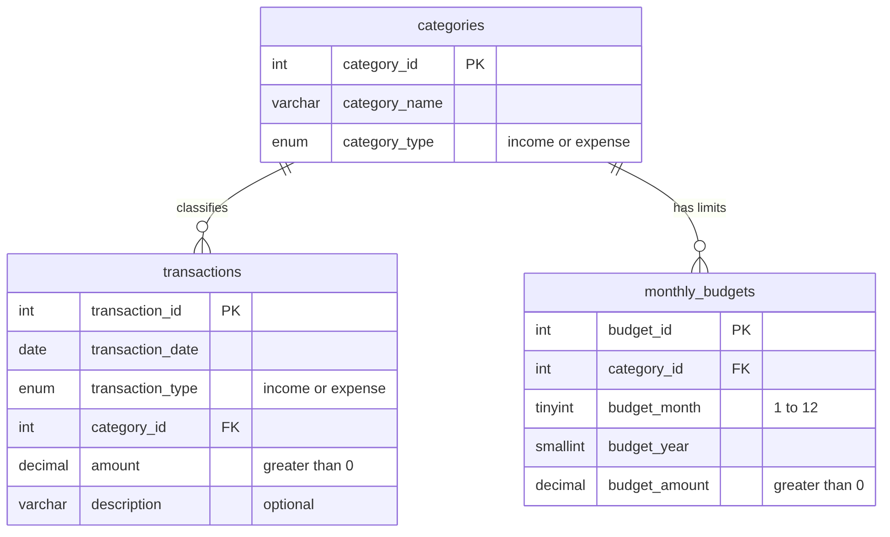

# D2. Database Design and Data Dictionary

Relationships: one category has many transactions (`ON DELETE RESTRICT`: a category in use cannot be deleted)
and many monthly budgets (`ON DELETE CASCADE`: deleting a category removes its budgets).
The SQL setup script is `schema.sql`; sample data is `sample_data.sql`.

## categories
| Column | Type | Rules | Meaning |
|---|---|---|---|
| category_id | INT, auto increment | PRIMARY KEY | Unique id |
| category_name | VARCHAR(50) | NOT NULL | Name shown to the user, e.g. Groceries |
| category_type | ENUM('income','expense') | NOT NULL | Which kind of transaction may use it |

Unique key `uq_category (category_name, category_type)` stops duplicates. 12 default rows are created by `schema.sql`.

## transactions
| Column | Type | Rules | Meaning |
|---|---|---|---|
| transaction_id | INT, auto increment | PRIMARY KEY | Unique id |
| transaction_date | DATE | NOT NULL, index `idx_txn_date` | Day the money moved |
| transaction_type | ENUM('income','expense') | NOT NULL | Must match the category type (checked by the application) |
| category_id | INT | NOT NULL, FOREIGN KEY to categories, index | Category of the record |
| amount | DECIMAL(12,2) | NOT NULL, CHECK amount > 0 | Always positive; the type says whether it is income or expense |
| description | VARCHAR(255) | NULL allowed | Optional note |

## monthly_budgets
| Column | Type | Rules | Meaning |
|---|---|---|---|
| budget_id | INT, auto increment | PRIMARY KEY | Unique id |
| category_id | INT | NOT NULL, FOREIGN KEY to categories | Expense category the limit applies to |
| budget_month | TINYINT | NOT NULL, CHECK 1 to 12 | Month of the limit |
| budget_year | SMALLINT | NOT NULL | Year of the limit |
| budget_amount | DECIMAL(12,2) | NOT NULL, CHECK > 0 | Spending limit |

Unique key `uq_budget (category_id, budget_month, budget_year)` allows one limit per category per month.

## Sample dataset (`sample_data.sql`)
| Month | Contents | Why it is there |
|---|---|---|
| Aug 2026 | 3 expenses, no income, one NULL description, 4 budgets | Deficit month (savings below 0, rate 0%); Groceries at exactly 100% (Warning, not Over); Utilities at exactly 80% (Warning boundary); a budget with no spending (0%) |
| Sep 2026 | 1 income, 4 expenses | Normal month used for the month-to-month comparison |
| Oct 2026 | 2 incomes, 5 expenses, 5 budgets | Main demonstration month: 3 categories Over, 2 Warning |

Months with no data (all other months) are shown as zero, which covers the empty-period case.
`sample_import.csv` has 6 valid rows and 6 invalid rows (bad date, negative amount, 3 decimals, unknown category,
type mismatch, missing amount) for the import demonstration.
